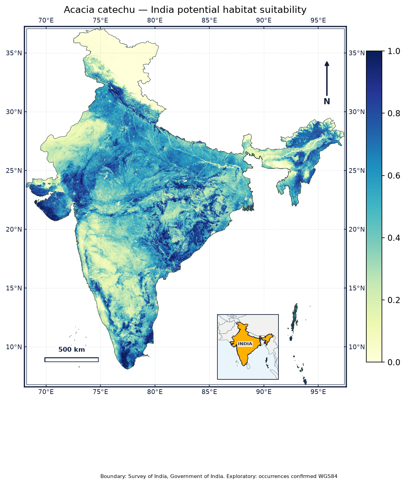
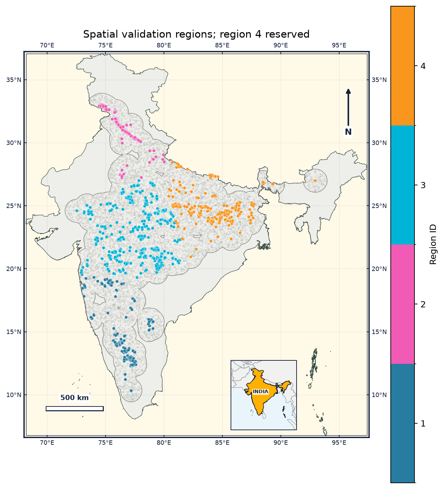

# *Acacia catechu* MaxEnt Habitat Suitability Modeling (India)

An end-to-end Python-based species distribution modeling (SDM) pipeline predicting the geographic habitat suitability of ***Acacia catechu* (L.f.) Willd. (Khair)** across India. The pipeline utilizes Maximum Entropy modeling (`elapid`), high-resolution bioclimatic predictors (WorldClim), SRTM terrain elevation, and a Sentinel-2 annual mean NDVI composite derived from Google Earth Engine.

---

## Overview

*Acacia catechu* is an economically and ecologically important deciduous tree native to South Asia, valued for catechu (*katha*), timber, tannins, and soil conservation in semi-arid and subtropical regions.

This repository implements a rigorous presence-background modeling workflow:
- **Study Extent**: Entire national territory of India on a standardized **30 arc-second (~1 km)** WGS84 grid.
- **Occurrence Records**: 1,279 verified spatial presence records cleaned and reviewed against national boundaries.
- **Environmental Predictors**: 19 WorldClim v2.1 bioclimatic variables, SRTM elevation, and a 2025 annual Sentinel-2 NDVI composite.
- **Multicollinearity Screening**: Pairwise correlation filtering ($|r| < 0.8$) and predictor cap selection.
- **Spatial Validation**: Spatial block partitioning (4 geographic regions) with holdout spatial evaluation and nested spatial cross-validation to minimize spatial autocorrelation bias.
- **Evaluation**: Held-out Area Under the Receiver Operating Characteristic Curve (AUC), 10th percentile training omission rate ($T_{10}$), response curves, jackknife tests, and permutation feature importance.

---

## Key Results & Figures

| Metric | Value | Interpretation |
| :--- | :--- | :--- |
| **Presences ($N$)** | 1,279 | Verified records inside India |
| **Background Points** | 10,000 | Sampled within 100 km accessible buffer |
| **Held-out Spatial AUC** | **0.729** | Discrimination in unseen geographic region |
| **Nested Spatial CV AUC** | **0.690 ± 0.05** | Mean across spatial cross-validation folds |
| **Held-out Omission ($T_{10}$)** | **3.02%** | Well within expected ~10% threshold |
| **Selected Predictors** | `ndvi`, `elevation`, `bio6`, `bio12`, `bio15`, `bio2`, `bio14` | Balanced climate, vegetation & topography |

### Spatial Distribution & Habitat Suitability

<div align="center">
  
  <p><em>Figure 1: Predicted habitat suitability index for Acacia catechu across India.</em></p>
</div>

<br/>

<div align="center">
  
  <p><em>Figure 2: Spatial block cross-validation partitions and occurrence locations.</em></p>
</div>

---

## Repository Structure

```text
acacia-catechu-maxent/
├── config/
│   └── analysis.json           # Model parameters, seeds, buffers, and grid settings
├── data/
│   ├── raw/
│   │   ├── occurrences/        # Raw species occurrence dataset (Excel)
│   │   ├── national/           # Environmental variable schema & reference grid definitions
│   │   ├── boundaries/         # Survey of India (SOI) administrative boundaries
│   │   ├── ndvi/               # Sentinel-2 NDVI composites & provenance sidecars
│   │   └── predictors_india/   # WorldClim and SRTM GeoTIFF raster layers
│   ├── interim/                # Geographic review audits, manifests, and run index
│   └── processed/              # Project-aligned reference grids and masked predictors
├── docs/
│   └── assignment.pdf          # Methodology and project brief documentation
├── notebooks/
│   └── acacia_catechu_india.ipynb  # Primary interactive modeling and reporting notebook
├── outputs/
│   ├── preparation/            # Occurrence verification context maps
│   └── runs/                   # Model runs containing tables, response curves, and maps
├── scripts/
│   ├── download_direct_seasonal.py   # Earth Engine direct composite fetcher
│   ├── export_ndvi_from_code_editor.js # GEE Code Editor export script
│   ├── ndvi_handoff.py         # Grid alignment, checksum, and provenance validator
│   ├── prepare_manual_ndvi.py  # Manual NDVI tile mosaic and verification tool
│   └── run_notebook.py         # Non-interactive headless notebook execution runner
├── pyproject.toml              # Dependencies and project specifications
└── README.md                   # Project documentation
```

---

## Installation & Setup

### 1. Prerequisites
- Python **3.11** or **3.12**
- [uv](https://github.com/astral-sh/uv) (recommended) or standard `pip` / `venv`

### 2. Clone the Repository
```bash
git clone https://github.com/24f-3004548/acacia-catechu-maxent.git
cd acacia-catechu-maxent
```

### 3. Create Environment and Install Dependencies

Using `uv`:
```bash
uv sync --all-extras
```

Or using `pip`:
```bash
python3 -m venv .venv
source .venv/bin/activate
pip install -e ".[geo,model,notebooks,earthengine]"
```

---

## Workflow & Execution

### Step 1: Sentinel-2 NDVI Acquisition
Authenticate with Google Earth Engine:
```bash
earthengine authenticate
```
Download the 2025 annual Sentinel-2 NDVI composite aligned to the national reference grid:
```bash
python scripts/download_direct_seasonal.py
```
*(Alternatively, use `scripts/export_ndvi_from_code_editor.js` within the GEE web console and place the exported GeoTIFF in `data/raw/ndvi/`)*.

### Step 2: Run the Model Pipeline
You can run the end-to-end analysis either interactively or headlessly:

- **Interactive Jupyter Notebook:**
  ```bash
  jupyter lab notebooks/acacia_catechu_india.ipynb
  ```

- **Headless Execution:**
  ```bash
  python scripts/run_notebook.py
  ```

The pipeline will:
1. Load and clean occurrence records, filtering by national SOI boundary.
2. Clip and mask WorldClim and SRTM raster predictors to the study domain.
3. Validate Sentinel-2 NDVI integrity and checksums via `scripts/ndvi_handoff.py`.
4. Sample 10,000 pseudo-absences within the accessible buffer (100 km).
5. Partition spatial blocks for group k-fold cross-validation.
6. Train the MaxEnt model with candidate features and regularization parameters (`beta`).
7. Export model evaluation metrics, spatial suitability rasters, response curves, and self-contained summary reports.

---

## Methodological Notes & Interpretive Caveats

- **Presence-Background vs. True Presence-Absence**: MaxEnt models relative habitat suitability (conditional likelihood), not true probability of occupancy. Background cells represent sampled environmental availability across the accessible region, not confirmed absences.
- **Spatial Autocorrelation**: Standard random train/test splits overestimate model accuracy due to spatial clustering. This pipeline uses geographic block cross-validation to assess transferability to unseen geographic regions.
- **Contemporary Remote Sensing**: NDVI captures recent vegetation density (2025 Sentinel-2 composite), complementing long-term climatological averages (WorldClim 1970–2000).

---

## Author & Academic Details

- **Author**: Hriman Saha
- **Student ID**: `M2024BSASS011`
- **Coursework Report**: `Hriman_Saha_M2024BSASS011_Acacia_catechu.pdf`
- **License**: [MIT License](LICENSE)

